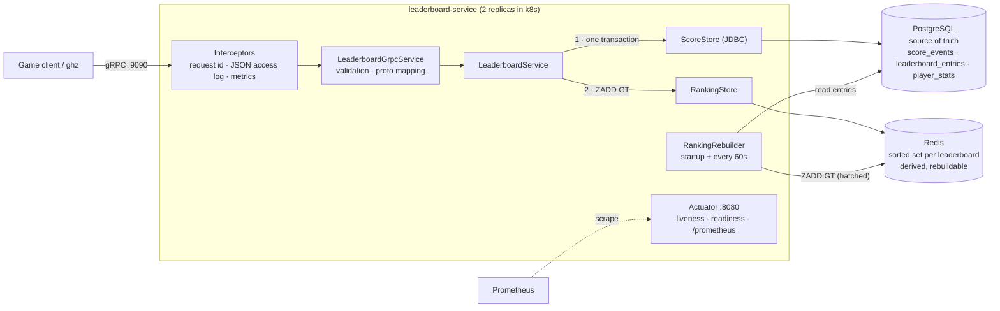
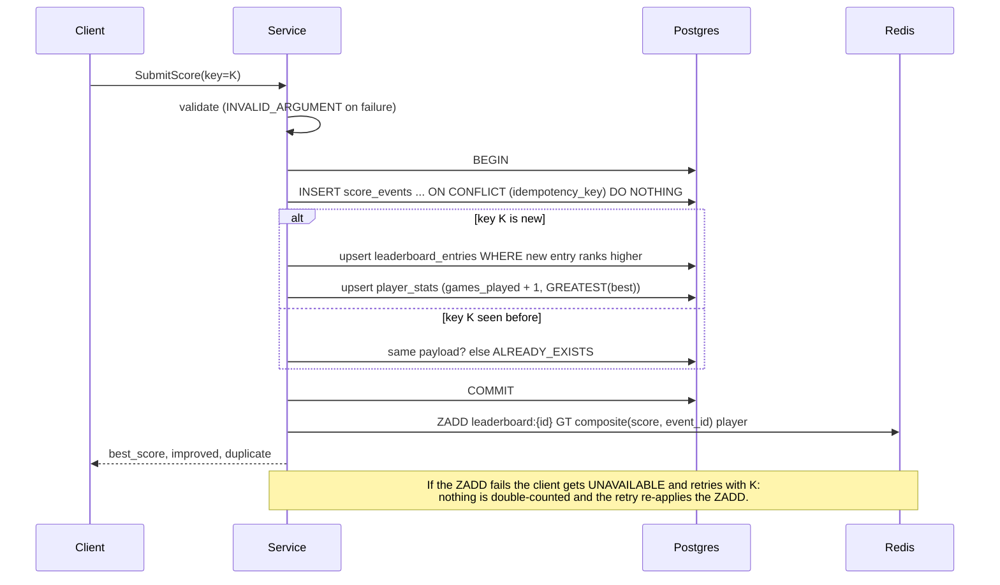

# leaderboard-service

[](https://github.com/vanshtaneja23/leaderboard-service/actions/workflows/ci.yml)

A player stats and leaderboard backend. Game clients submit scores over **gRPC**. The service keeps **PostgreSQL** as the source of truth and maintains **Redis sorted sets** for fast rankings, and it answers top-N, "my rank and the players around me", and lifetime player stats.

**Stack:** Java 21 · Spring Boot 4.1 · Spring gRPC 1.1 · Protocol Buffers · PostgreSQL 18 + Flyway · Redis 8 · Micrometer/Prometheus · Docker · Kubernetes (kind) · JUnit 5 + Testcontainers · GitHub Actions

> **Why Spring Boot 4.1 and not 3.x?** The maintained Spring gRPC integration (1.x) requires Boot 4; on Boot 3.5 the only options are Spring gRPC 0.x (pre-1.0, no longer developed) or `net.devh` (last release 2024). In Boot 4.1 the gRPC server starter ships with Spring Boot itself.

---

## What it does

| RPC | What it returns | Error codes |
|---|---|---|
| `SubmitScore(player_id, leaderboard_id, score, idempotency_key)` | the player's best score, whether this submission became their ranking entry, whether it was a duplicate | `INVALID_ARGUMENT`, `ALREADY_EXISTS` (key reused with a different payload), `UNAVAILABLE` (safe to retry) |
| `GetTopN(leaderboard_id, n)` | the top `n` (1–100) players, best first | `INVALID_ARGUMENT`, `NOT_FOUND` (no entries) |
| `GetPlayerRank(leaderboard_id, player_id, neighbors)` | the player's 1-based rank plus up to `neighbors` (0–50) players above and below | `INVALID_ARGUMENT`, `NOT_FOUND` |
| `GetPlayerStats(player_id)` | games played, best score, last updated (across all leaderboards) | `INVALID_ARGUMENT`, `NOT_FOUND` |

The full contract is in [`src/main/proto/leaderboard.proto`](src/main/proto/leaderboard.proto). Ranking rules: a higher score ranks first, and **on equal scores the earlier submission ranks higher**.

## Architecture



The write path for `SubmitScore`:



## Running it

Prerequisites: Docker, JDK 21 (only for running tests outside Docker), [`ghz`](https://ghz.sh) for the load test, and [`kind`](https://kind.sigs.k8s.io) + `kubectl` for Kubernetes.

### docker compose

```bash
make up          # builds the image, starts service + Postgres + Redis, waits for readiness
```

`make up` creates `.env` from [`.env.example`](.env.example) (placeholder credentials). gRPC is served on `localhost:9090` and actuator on `localhost:8080`:

```bash
ghz --insecure --proto src/main/proto/leaderboard.proto -n 1 \
  --call leaderboard.v1.LeaderboardService/SubmitScore \
  -d '{"player_id":"alice","leaderboard_id":"weekly","score":"4200","idempotency_key":"7b0c…"}' localhost:9090

curl localhost:8080/actuator/health/readiness
curl localhost:8080/actuator/prometheus | grep grpc_server_seconds
make down        # stop and delete volumes
```

### Kubernetes (kind)

```bash
make kind-deploy   # creates the "leaderboard" kind cluster if needed, loads the image, applies k8s/
make kind-forward  # port-forwards the Service to localhost:9090 and localhost:8080
make kind-delete
```

[`k8s/`](k8s) contains a Deployment (2 replicas, startup, liveness and readiness probes, resource requests and limits, zero-downtime rollout, preStop delay), Service, ConfigMap, a Secret with **placeholder** values, and single-instance Postgres (StatefulSet + PVC) and Redis for local use.

### Tests

```bash
make test          # needs Docker: Testcontainers starts real Postgres 18 and Redis 8
```

51 tests: unit tests for the score encoding and error mapping, store-level tests against real Postgres/Redis, end-to-end gRPC tests (in-process transport), a Redis-recovery test that boots a second application instance, observability tests, and the concurrency tests described below. CI runs the same suite plus a Docker build on every push.

## Design decisions & trade-offs

### Why Redis sorted sets for rankings

A sorted set (ZSET) is a skip list plus a hash map. `ZADD`, `ZREVRANK` (a player's rank) and `ZREVRANGE` (top-N or a window around a rank) are all O(log N), served from memory, so "what is my rank among a million players" is a few microseconds of Redis work. The same question in SQL is `COUNT(*) WHERE score > mine` or a window function over the whole board, which gets slower as the board grows and competes with the write traffic.

`GetPlayerRank` needs the rank *and* the neighbors. Doing `ZREVRANK` and then `ZREVRANGE` as two calls would let another write shift ranks in between, so both run in **one Lua script**, which Redis executes atomically.

### Why Postgres is the source of truth

Redis here runs without persistence and is treated as a cache: a derived index that can be thrown away. Postgres provides what Redis doesn't: durable, transactional writes, a **unique constraint** for idempotency, the full event history (`score_events`), and lifetime stats. Every Redis entry can be recomputed from the `leaderboard_entries` table, so losing Redis costs a rebuild, not data.

### Consistency between Postgres and Redis

This is a dual write, so it needs an explicit answer for every failure:

| What happens | Result | Why it's safe |
|---|---|---|
| Postgres transaction fails | Nothing is written anywhere; the client gets an error | Redis is only written **after** commit |
| Commit succeeds, Redis `ZADD` fails | Client gets `UNAVAILABLE` and retries with the same key | The retry is a duplicate in Postgres (not double-counted) but **re-applies the `ZADD`**, repairing Redis (tested) |
| Process dies between commit and `ZADD` | Redis is missing one improvement | Client retry repairs it; otherwise the periodic reconcile does |
| Redis restarts and loses everything | Rankings are empty until rebuilt | `RankingRebuilder` rebuilds on startup (before readiness) and every 60s |
| Rebuild races live writes / two replicas rebuild at once | Fine | All writes are `ZADD ... GT` |

The key property is **`ZADD GT` makes every Redis write a "max" operation**: commutative (order doesn't matter) and idempotent (repeating it changes nothing). So concurrent writers, retries, out-of-order arrivals and a full rebuild racing live traffic all converge to the same state without locks.

Rebuild detection compares each key's `ZCARD` with the Postgres entry count, not just "does the key exist?". That catches a Redis that restarted and then received a few live writes before any rebuild ran (also tested).

**Known gap:** between a mid-run Redis restart and the next reconcile (up to 60s, 30s in k8s) reads can be incomplete. I watched this happen on the compose stack: `GetTopN` returned `NOT_FOUND` right after `docker compose restart redis` and recovered about 35s later. Detecting the restart directly (Redis `run_id` changes) would shrink that window.

### Tie-breaking: equal scores rank the earlier submission higher

Redis compares one double per member, so both sort keys are packed into it ([`RankScore`](src/main/java/dev/vansh/leaderboard/core/RankScore.java)):

```
 bit 52 ............. 27 | 26 ................ 0
 [        score         ] [ MAX_EVENT_ID - event_id ]
```

- The **score** sits in the high bits, so any score difference outweighs any tie-breaker.
- The **event id** is the Postgres identity of the `score_events` row, which is monotonic and assigned at insert, so "earlier submission" means "lower id". It is stored **inverted**, so earlier gives a larger value and ranks higher in a descending sort.
- A double represents every integer up to 2^53 exactly, and the composite never exceeds that, so the encoding is lossless and comparisons are exact. Tests cover the extremes, including the two largest adjacent values.
- **Cost:** scores are capped at 2^26−1 (67,108,863) and event ids at 2^27−1 (134,217,727). The limits are enforced by request validation **and** by CHECK constraints in Postgres (migration V2), so running out fails loudly instead of mis-ranking. At real scale, see below.

Postgres uses the **same order**: the `leaderboard_entries` upsert only replaces a row when `(score, -event_id)` is greater. Without that clause, two equal-score submissions committing out of id order would leave Postgres and Redis disagreeing about which one ranks.

### Idempotency

The client sends an `idempotency_key` (e.g. a UUID) and reuses it on every retry. The transaction starts with:

```sql
INSERT INTO score_events (...) VALUES (...) ON CONFLICT (idempotency_key) DO NOTHING RETURNING id
```

The **unique constraint** does the work. A check-then-insert in Java would have a race window. If two retries race, the second blocks on the unique index until the first commits, then inserts nothing. A replay returns `duplicate=true` with the current best score and counts nothing. Reusing a key with a *different* payload is a client bug and returns `ALREADY_EXISTS`.

### Concurrency

There are no Java locks; correctness comes from the SQL:

- `ON CONFLICT ... DO UPDATE ... WHERE` evaluates the "does the new entry rank higher?" condition **while holding the row lock**, so concurrent submissions for one player serialize and the best one wins.
- Counters are incremented in SQL (`games_played = games_played + 1`, `GREATEST(...)`), never read-modify-written in Java, so no updates are lost.
- Locks are always taken in the same order (idempotency key → ranking entry → player stats), so these transactions cannot deadlock each other.

[`ConcurrencyTest`](src/test/java/dev/vansh/leaderboard/ConcurrencyTest.java) fires **1,000 concurrent `SubmitScore` calls from 64 threads** behind a start latch. The workload has frequent ties and 100 concurrent retries of existing keys. Every rank (`GetTopN`, `GetPlayerRank`), every ranking entry in Postgres and every player stat is compared with an independently computed model, and finally Redis is wiped, rebuilt from Postgres, and must match exactly.

**I checked that the test can fail.** With the tie clause deleted from the upsert, the 1,000-call test still passed, because that interleaving is rare when submissions are spread over many players. So a second test sends 200 equal-score submissions for one player at once. With the clause removed, it **failed 3 of 3 runs** (Postgres kept event 6, 8 or 11 instead of 1); with the real code it passed 5 of 5 runs.

### Observability

- **Probes:** readiness includes Postgres and Redis; liveness deliberately does not. A database outage should take pods out of rotation, not make Kubernetes restart them in a loop.
- **Metrics:** per-RPC request count and latency **histogram buckets** (`grpc_server_seconds_bucket{rpc_method, grpc_status_code}`), so p99 can be aggregated across pods with `histogram_quantile`, plus `leaderboard_submissions_total{result}` and `leaderboard_rebuilds_total` (should stay at 0; alert if it moves).
- **Logs:** one JSON object per line (Elastic Common Schema). Every RPC gets a `request_id`: the caller's `x-request-id` if it matches a safe pattern, otherwise a UUID. It is put in the MDC around each gRPC callback, because gRPC can hop threads and MDC is thread-local. It is echoed back in response headers/trailers, and an access-log line records the method, status and duration.

### What I'd change at real scale

- **Write path → outbox / change data capture.** Replace the dual write with an outbox table, or CDC from the Postgres WAL (e.g. Debezium → Kafka), feeding a ranking consumer. Redis becomes explicitly eventually consistent, the gap between commit and `ZADD` disappears, and Redis can be rebuilt by replaying the stream.
- **Sharding.** Each leaderboard is one Redis key, so leaderboards spread naturally across a Redis Cluster. One giant board (a global all-time board with 100M players) needs splitting: score-range buckets with per-bucket counts give an exact rank as "players in higher buckets + rank within bucket". Past that, use approximate percentiles for everyone outside the top N.
- **Hot leaderboards.** Cache `GetTopN` for ~1s (everyone asks for the same top 10), serve reads from Redis replicas, batch or coalesce `ZADD`s per player, and rate-limit submissions per player.
- **Postgres growth.** Partition `score_events` by time with a retention policy. The reconcile's `GROUP BY` count should become maintained counters or Redis restart detection.
- **Tie-break limits.** Replace the global event id with a per-leaderboard sequence (bits reset per board or season), or store the tie-breaker in the member string and maintain it with a Lua script, removing the 2^27 cap.
- **gRPC load balancing.** gRPC multiplexes requests over long-lived HTTP/2 connections, so a plain Kubernetes Service (L4) pins each client connection to one pod. Real deployments need L7 balancing: a headless Service with client-side round-robin, or a proxy or mesh (Envoy, Linkerd).
- **Security.** There is no authentication or TLS here. A real deployment needs mTLS between services, and scores should only come from a trusted game server, never directly from a client, which is the anti-cheat boundary.

## Load test

All numbers below were measured on my machine with [`loadtest/run.sh`](loadtest/run.sh). The raw ghz reports (minus per-request details) are in [`docs/loadtest/`](docs/loadtest).

**Hardware/software:** Apple M4 Pro (12 cores), 24 GB RAM, macOS 26.5.2 · Docker Desktop 29.0.1 (Linux VM: 12 CPUs, 7.65 GiB) · service, Postgres 18.6 and Redis 8.8 running in docker compose, **one** service instance · ghz 0.121.0 running on the same machine as the client.

**Command:**

```bash
make up && make loadtest
# = ./loadtest/run.sh localhost:9090 with DURATION=30s CONCURRENCY=50 CONNECTIONS=10 PLAYERS=10000
```

The script seeds 10,000 players (one `SubmitScore` each, which also warms up the JIT; not reported). It then runs each RPC on its own for 30s with 50 concurrent workers over 10 HTTP/2 connections. For example, the `GetTopN` step is:

```bash
ghz --insecure --proto src/main/proto/leaderboard.proto \
  --call leaderboard.v1.LeaderboardService/GetTopN \
  --connections 10 -c 50 -z 30s \
  -d '{"leaderboard_id":"load-20261001-013559","n":10}' localhost:9090
```

`SubmitScore` uses random players among the 10,000, random scores and a fresh UUID idempotency key per call. `GetPlayerRank` asks for 5 neighbors above and below.

**Run 1** (2026-10-01 01:35 local time):

| RPC | Requests | RPS | p50 (ms) | p99 (ms) | Non-OK |
|---|---:|---:|---:|---:|---:|
| SubmitScore | 243,438 | 8,115 | 5.77 | 12.92 | 45 |
| GetTopN | 561,711 | 18,724 | 2.24 | 8.39 | 46 |
| GetPlayerRank | 533,481 | 17,783 | 2.41 | 8.08 | 49 |
| GetPlayerStats | 610,166 | 20,339 | 1.98 | 8.36 | 49 |

**Run 2** (immediately after, same settings):

| RPC | Requests | RPS | p50 (ms) | p99 (ms) | Non-OK |
|---|---:|---:|---:|---:|---:|
| SubmitScore | 237,664 | 7,922 | 5.90 | 13.43 | 50 |
| GetTopN | 555,566 | 18,519 | 2.28 | 8.25 | 50 |
| GetPlayerRank | 525,517 | 17,517 | 2.47 | 8.00 | 50 |
| GetPlayerStats | 613,579 | 20,453 | 1.97 | 8.38 | 50 |

**About the Non-OK column:** every one of them is `Unavailable: use of closed network connection`, reported by the *client*. They are the requests still in flight (at most 50, the concurrency) when ghz's 30s timer fired and it closed its connections. The seed step, which runs to a fixed count instead of a timer, had 0 errors. After run 1 the server's own metrics showed only `OK`, plus a few `UNKNOWN` for calls cancelled by the disconnect, with no `INTERNAL` or `UNAVAILABLE`. For `SubmitScore`, the server recorded 43 more successes than ghz did (completed after ghz hung up), and the other 2 of the 45 were cancelled.

**How to read these numbers:** `SubmitScore` is a 3-statement Postgres transaction plus a Redis round trip, so it is the slowest. Reads hit only Redis (or one Postgres primary-key lookup for stats). This is one JVM, one Postgres and one Redis sharing a laptop's Docker VM with the load generator, with JSON access logging on for every call. Treat it as a baseline for this setup, not a capacity claim for production hardware.

## Project layout

```
src/main/proto/leaderboard.proto        API contract
src/main/java/dev/vansh/leaderboard/
  api/      gRPC adapter, validation, exception → status mapping, request-id interceptor
  core/     LeaderboardService (orchestration), RankScore (tie-break encoding), domain records
  store/    ScoreStore: Postgres access, the transactional write path
  ranking/  RankingStore (Redis sorted sets), RankingRebuilder (recovery)
src/main/resources/db/migration/        Flyway migrations
src/test/java/...                       Testcontainers-backed tests
k8s/  Dockerfile  compose.yaml  Makefile  loadtest/  .github/workflows/ci.yml
```

## Not implemented

Authentication and TLS, leaderboard lifecycle (create, reset, seasons), pagination beyond top 100, Redis restart detection faster than the reconcile interval, and a Prometheus/Grafana stack (the service exposes metrics but none of the deployments scrape them).
